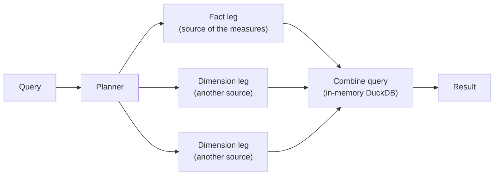

# Federated Queries

A model's data objects can live in different databases. A query that reads
data objects of more than one [data source](data-sources.md) is a *federated
query*: OBSL splits it into one query per source, runs them at once, and
combines their results in an in-memory DuckDB. The answer is the one a single
database holding all the tables would return, or the query is refused with a
named `FEDERATION_*` error. It is never answered with a different number.

This page explains how a query is split, where each filter runs, how each
aggregation is combined, what the run time settings are, and every
[limitation](#limitations).

## Declaring the sources

Each data object names the data source its table is read from, in
`dataSource`, which overrides the model's `settings.defaultDataSource`:

```yaml
settings:
  defaultDataSource: shop        # MySQL
dataObjects:
  Orders:
    code: orders                 # read from shop
    joins:
      - {joinType: many-to-one, joinTo: Customers,
         columnsFrom: [Customer], columnsTo: [Customer ID]}
  Customers:
    code: customers
    dataSource: crm              # PostgreSQL
```

The sources themselves are configured by name (`OBSL_DATABASES=shop,crm`,
`DB_SHOP_TYPE=mysql`, ...); see [Data Sources](data-sources.md). A query on
such a model that reads one source only is not split: it runs on that source,
in its dialect.

## How a query is split



- **Islands.** The query's data objects that share a source and are joined
  among themselves form an *island*. The island the measures' values come
  from, which also holds the query's base object, is the *fact island* (in a
  [query without measures](#queries-without-measures), the base object's);
  every other island is a *dimension island*, reached from the fact island by
  one many-to-one join, a *federation edge*.
- **Legs.** Each island becomes a *leg*: an ordinary OBSL query against a model
  holding that island alone, written in its source's dialect. The **fact leg**
  groups by the query's dimensions on its island and by the edge keys, and
  pre-aggregates the measures, or returns its rows where a measure needs them
  ([computed from rows](#computed-from-rows)). A **dimension leg** returns the
  distinct keys with the dimensions the query reads there, and any column a
  measure reads there ([measures reading another source](#measures-reading-another-source)). A source not configured where the
  query is compiled gets the dialect the query is compiled for.
- **Combine.** The combine query is the original query, compiled for DuckDB
  against a model whose data objects are the legs: the fact leg joins each
  dimension leg on its key, many-to-one, as `LEFT JOIN`, and each measure is
  re-aggregated from the fact leg's results. Derived metrics, HAVING, ORDER BY,
  LIMIT, totals and `rollup` / `cube` subtotals run there. A fact row whose key
  has no match keeps its values under an empty group, as in one database.

## An example

Revenue and orders by region, orders in MySQL (`shop`), customers in
PostgreSQL (`crm`), for the region EU:

```yaml
select:
  dimensions: [Region]
  measures: [Revenue, Orders Count]
where:
  - {field: Region, op: "=", value: EU}
```

The fact leg, on MySQL, sums and counts per customer:

```sql
SELECT `Orders`.`customer_id` AS `__fk0_0`, CAST(COUNT(1) AS SIGNED) AS `Orders Count`,
       SUM(`Orders`.`amount`) AS `Revenue`
FROM `orders` AS `Orders`
GROUP BY `Orders`.`customer_id`
ORDER BY `__fk0_0` ASC
LIMIT 1000001
```

The dimension leg, on PostgreSQL, returns the customers of the region, and
runs the filter itself:

```sql
SELECT "Customers"."region" AS "Region", "Customers"."customer_id" AS "__fk0_0"
FROM "customers" AS "Customers"
WHERE "Customers"."region" = 'EU'
GROUP BY "Customers"."region", "Customers"."customer_id"
ORDER BY "Region" ASC, "__fk0_0" ASC
LIMIT 1000001
```

The combine query, in DuckDB, joins them on the customer key, keeps the fact
rows the filtered leg matched, and adds up the partial results:

```sql
SELECT "leg_1"."Region" AS "Region", CAST(SUM("leg_0"."Revenue") AS DECIMAL(18, 2)) AS "Revenue",
       CAST(COALESCE(SUM("leg_0"."Orders Count"), 0) AS INTEGER) AS "Orders Count"
FROM "leg_0" AS "leg_0"
LEFT JOIN "leg_1" AS "leg_1" ON "leg_0"."__fk0_0" = "leg_1"."__fk0_0"
WHERE "leg_1"."__fk0_0" IS NOT NULL
GROUP BY ALL
```

Since the PostgreSQL leg runs a filter, the MySQL leg runs after it and reads
only the customers it returned ([key injection](#key-injection)): at run time
its `WHERE` gains `"customer_id" IN (...)`. `query/sql` and `obsl compile`
show the plan as compiled, before any key is known.

Each leg asks for one row more than `FEDERATION_MAX_LEG_ROWS` (default
1,000,000), so a leg past the limit is refused rather than combined in part.

## Where filters run

| Filter | Runs in | Why |
|---|---|---|
| On the fact island's dimensions | the fact leg | as on one database |
| On one dimension island's dimensions, never true where they are all NULL (`=`, `!=`, `in`, comparisons, `like`, `relative`, ...) | that dimension leg, and the combine query keeps the fact rows it matched | compared as its own engine compares; the fact leg may then read only the keys it returned |
| True where the dimensions are NULL (`is_null`, `blank`, ...), or reading several islands (an OR across sources) | the combine query, after the join | in a dimension leg it would also match the fact rows whose key the leg dropped |
| After the join, on a dimension the query selects at a time grain (`Order Date:month`, filtered on `Order Date`) | the combine query, on a column the dimension's leg returns beside it: the dimension at its own grain (the day, or its declared `timeGrain`) | as on one database: `Order Date < 2024-01-15` compares each order's day, not the month selected |
| `relative`, after the join | the combine query, counting from the combine step's date | see [Results that can differ](#results-that-can-differ-from-one-database) |
| A static model filter on the fact island | the fact leg | |
| A static model filter on another island | the combine query, on a column that island's leg returns | it drops the rows it excludes and keeps an unmatched row when it holds for NULL; `enforce: always` applies even when the query reads nothing else of that island, and in the body of an `exists` subquery on that island too, as on one database |
| `exists` on its subject's island, `nonexists` on the fact island | the leg of the subject's island, with its subquery | as on one database |
| `nonexists` on a dimension island | a leg of its own returning that island's keys the subquery holds for (`exists`); the combine query keeps the fact rows whose key is not among them | it holds for a fact row with no row there (an order whose customer is missing), which a filter in the dimension leg would drop |

### Exists subqueries

An [`exists` / `nonexists`](query-language.md#existence-operators) filter runs
on the data source of its subject, with its whole subquery: the target, the
join path from the subject to it, every object its own filters and the
`enforce: always` static filters read, and the objects joined to reach them,
must be of that source. "Revenue from customers with a high-severity ticket" runs
where the customers and tickets are, and the fact leg then reads only those
customers' keys:

```yaml
where:
  - field: Customers.Customer ID     # crm
    op: exists
    subquery:
      dataObject: Tickets            # crm
      filter:
        - {field: Severity, op: equals, value: high}
```

With `op: nonexists` instead, by region, a leg of its own on the CRM returns
the keys of the customers who do have such a ticket, and the combine query
left-joins it and keeps the orders whose key found none, so an order whose
customer is missing stays, as on one database:

```sql
-- leg_2, on crm
SELECT "Customers"."customer_id" AS "__fk0_0"
FROM "customers" AS "Customers"
WHERE EXISTS (
SELECT 1
FROM "tickets" AS "Tickets"
WHERE "Customers"."customer_id" = "Tickets"."customer_id" AND "Tickets"."severity" = 'high'
)
GROUP BY ALL
ORDER BY "__fk0_0" ASC
LIMIT 1000001
```

```sql
-- combine
SELECT "leg_1"."Region" AS "Region", CAST(SUM("leg_0"."Revenue") AS DECIMAL(18, 2)) AS "Revenue"
FROM "leg_0" AS "leg_0"
LEFT JOIN "leg_1" AS "leg_1" ON "leg_0"."__fk0_0" = "leg_1"."__fk0_0"
LEFT JOIN "leg_2" AS "leg_2" ON "leg_0"."__fk0_0" = "leg_2"."__fk0_0"
WHERE "leg_2"."__fk0_0" IS NULL
GROUP BY ALL
```

The combine query runs no subquery, so an `exists` that would run there,
after the join, is refused: in an OR with a condition on another source, or
in a group that holds where its subject is missing.

### Key injection

When a dimension leg runs a filter, the fact leg would still aggregate every
key, and the combine query would drop the ones the filter rejected. When the
filter keeps few keys, the fact leg runs after that leg instead and reads only
them, as `key IN (...)`: the engine aggregates those rows alone, and with an
index or sort key on the column reads only those. The answer is the same.

| What | How |
|---|---|
| When | A dimension leg runs a filter of the query, joined on one column of the same type on both sides, an integer or a string |
| How many | At most the fact source's limit of keys, over every such leg together, the legs with the fewest keys first. A leg with more keys than are left is not listed, and the fact leg reads all of that key. No key at all reads no fact row |
| Limit | Postgres, MySQL, ClickHouse and BigQuery 10,000; DuckDB, Snowflake, Databricks and Dremio 1,000. `DB_<NAME>_KEY_INJECTION_MAX_KEYS` sets it for the fact leg's source, `DB_KEY_INJECTION_MAX_KEYS` for every source; `0` turns it off |
| Cost | The fact leg waits for the dimension legs rather than running beside them. A list past the limit gains nothing over aggregating every key |
| Not listed | A list making a statement longer than the engine parses, ClickHouse's default `max_query_size` (256 KiB) or BigQuery's 1,024K characters, and a string key holding a NUL, which ends a Postgres statement's text: the fact leg reads every key instead. Snowflake refused a list of 300,000 values, where 200,000 passed |

The limits come from a measurement with 5 million orders over 1 million
customers, the filter keeping 10 to 100,000 of them:

| Fact leg on | Every key | 10 keys | 1,000 | 10,000 | 100,000 |
|---|---|---|---|---|---|
| Postgres 16 | 1.32 s | 0.10 s | 0.10 s | 0.14 s | 0.38 s |
| Postgres 16, indexed | 1.32 s (*) | 0.013 s | 0.021 s | 0.12 s | 0.39 s |
| MySQL 8.0 | 7.0 s | 0.92 s | 0.96 s | 0.96 s | 1.25 s |
| MySQL 8.0, indexed | 7.1 s | 0.017 s | 0.022 s | 0.12 s | 7.06 s (index unused) |
| ClickHouse | 0.85 s | 0.021 s | 0.045 s | 0.078 s | refused (`max_query_size`) |
| DuckDB | 0.040 s | 0.022 s | 0.034 s | 0.11 s | 0.93 s |
| BigQuery | 21 s | 1.05 s | 1.21 s | 2.20 s | 11.6 s |
| Snowflake (first time a list is sent) | 0.53 s | 0.20 s | 0.40 s | 1.42 s | 15.3 s |
| Databricks | 1.50 s | 0.33 s | 0.39 s | 0.87 s | 4.96 s |
| Dremio | 0.41 s | 0.12 s | 0.17 s | 0.44 s | 1.38 s |

Median of three runs on a laptop, the dimension leg on Postgres 16; the last
four timed on the fact leg alone, through OBSL's executor, which fetches the
million rows of every key as Arrow. Snowflake answered a list sent again under
another comment three to eight times faster, but a filter's list is new each
time, so its row shows the first. (*) For every key Postgres chose an index
scan over the indexed copy and took 11 s; the row shows the unindexed time.

!!! warning "Postgres 13 and older"
    Before Postgres 14 an `IN` list is tested one value at a time: 10,000
    keys over 5 million rows took 51 s, against 2 s without the list. Set
    `DB_<NAME>_KEY_INJECTION_MAX_KEYS=0` for such a server.

## Queries without measures

A query selecting dimensions alone returns the combinations the fact rows
reach, as one database does. For `Order Date:month` and `Region`, that is each
month with the region of every customer who ordered in it, and NULL for an
order whose customer is missing; no month is paired with a region its orders
do not reach.

- the fact leg returns its dimensions and the join keys, each combination once
  (grouped, with no measure);
- each dimension leg returns its keys and dimensions, as for any query;
- the combine query groups the joined rows.

Filters run where they would beside a measure, and a filter on another source
injects its keys into the fact leg. The fact leg returns each combination of
its dimensions with the join key, which can be many more rows than the result
(months by customers for months by regions); `FEDERATION_MAX_LEG_ROWS` bounds
it as any leg. Dimensions of one source alone run on that source and are not
federated. Dimensions of another source with a filter on the facts' source
are refused as on one database: the customers do not reach the orders.

Value search (`POST .../values`) runs such queries too, so a dimension's
values can be listed under a filter on another source.

## Role-playing dimensions

A dimension that plays a role ([`via`](model-format.md#role-playing-dimensions-via),
with a [`pathName`](model-format.md#several-roles-in-one-query-pathname)) reads
its data object through one of several joins. One database joins each role
under an alias of its own. Across sources, each role of a dimension source is
a dimension leg of its own, reading the table under that alias, and the fact
leg returns each role's key. For an order's sales and support employee, both
in the CRM:

```sql
-- leg_0, on shop
SELECT "Orders"."sales_id" AS "__fk0_0", "Orders"."support_id" AS "__fk1_0", SUM("Orders"."amount") AS "Revenue"
FROM "orders" AS "Orders"
GROUP BY ALL

-- leg_1, on crm
SELECT "Employees__Orders__sales"."name" AS "Sales Employee", "Employees__Orders__sales"."employee_id" AS "__fk0_0"
FROM "employees" AS "Employees__Orders__sales"
GROUP BY ALL

-- leg_2, on crm
SELECT "Employees__Orders__support"."name" AS "Support Employee", "Employees__Orders__support"."employee_id" AS "__fk1_0"
FROM "employees" AS "Employees__Orders__support"
GROUP BY ALL

-- combine
SELECT "leg_1"."Sales Employee" AS "Sales Employee", "leg_2"."Support Employee" AS "Support Employee", CAST(SUM("leg_0"."Revenue") AS DECIMAL(18, 2)) AS "Revenue"
FROM "leg_0" AS "leg_0"
LEFT JOIN "leg_1" AS "leg_1" ON "leg_0"."__fk0_0" = "leg_1"."__fk0_0"
LEFT JOIN "leg_2" AS "leg_2" ON "leg_0"."__fk1_0" = "leg_2"."__fk1_0"
GROUP BY ALL
```

A role whose join stays within one source (a customer's account manager,
customers and employees both in the CRM) runs in that source's leg, as on one
database. A static filter on the role's data object filters that object as
the model declares it, joined through its primary join, not a role's copy, as
on one database: with a filter on `Employees`, an order is kept by its sales
employee's team, whichever role the query selects.

## How measures combine

Most measures combine from **partial results** the fact leg computes per
group. Those that do not are computed **from the fact leg's rows**.

| Aggregation | The fact leg returns | The combine query computes |
|---|---|---|
| `sum`, `count`, synthesized counts | the sum, the count | the sum of them; a count over no rows is 0 |
| `min`, `max`, `any_value` | the minimum, maximum, any value | the minimum, maximum, any value of them |
| `avg` | its argument's sum and count | the summed sums over the summed counts, exactly |
| `count_distinct` of one column | groups by that column too | its distinct values across every group they reach |
| `variance`, `var_pop`, `stddev`, `stddev_pop` of integers or declared decimals | count, sum and sum of squares, each value squared exactly | the statistic from their totals, exactly |
| anything else | its rows | each measure, in DuckDB |

### Partial results

- **Not rounded, not bounded.** A leg leaves its sums in the engine's own type,
  which keeps the input's scale and the engine's range; the measure's type and
  `defaultValue` apply once, to the combined value.
- **`avg`** is not an average of averages. For an integer or decimal measure
  the combine query divides exactly, in integers, and rounds half away from
  zero to the measure's type, as PostgreSQL, MySQL and Snowflake round their
  own `AVG`; HAVING, ORDER BY and metrics read the average before that
  rounding, at 18 places or more. A `float` measure divides as doubles. The
  decimal sums are read at 9 places, the most an engine returns one at
  (BigQuery `NUMERIC`); a sum with more places is refused
  (`FEDERATION_LEG_TYPE`), never rounded.
- **`count_distinct`** counts are not added: the fact leg also groups by the
  counted column, which `FEDERATION_MAX_LEG_ROWS` bounds. Beside a measure of
  another data object the query is computed from rows instead.
- **Variances** combine from their moments, each value squared in a type wide
  enough to keep every digit (`DECIMAL(38, s)`, `NUMERIC`, `BIGNUMERIC` or
  `Decimal256`, by engine), added as 128-bit integers, shifted by the integer
  mean, rounded once to a double: exact, also on Snowflake and Dremio, whose
  own `STDDEV` cancels far from zero. The values must be integers or a decimal
  column declared with `sqlPrecision` and `sqlScale`, of up to 3 places on
  Databricks and Dremio, 6 on Snowflake, 15 on MySQL and 19 on the others;
  past those, the query is computed from rows. A sum of squares past 128 bits
  raises an error rather than wrapping.

### Computed from rows

When a measure does not combine from partial results (a `median`, a
percentile, `mode`, `first`, `last`, `listagg`, a correlation, covariance or
regression, a variance of floats, a `distinct` aggregation, a filtered
`count_distinct`, an `avg` or `count_distinct` with `total: true`, ...), the
fact leg returns its rows instead:

- it also groups by every column a measure reads (its argument, filters,
  ordering and expression), and counts the rows of each group, `__rows`, so
  equal rows travel once;
- the combine query repeats each group that many times (a `range()` join in its
  own SQL) and computes **every** measure of the query from those rows, as one
  database computes it from its own.

For the median order amount by region, the MySQL fact leg becomes:

```sql
SELECT `Orders`.`customer_id` AS `__fk0_0`, `Orders`.`amount` AS `__value0`,
       CAST(COUNT(1) AS SIGNED) AS `__rows`
FROM `orders` AS `Orders`
GROUP BY `Orders`.`customer_id`, `Orders`.`amount`
```

and the combine query starts with:

```sql
WITH "leg_0_rows" AS (
SELECT "__leg".* EXCLUDE ("__rows")
FROM "leg_0" AS "__leg", range(CAST(COALESCE("__leg"."__rows", 0) AS BIGINT))
)
SELECT "leg_1"."Region" AS "Region", MEDIAN(CAST("leg_0"."__value0" AS DOUBLE)) AS "Median Order"
FROM "leg_0_rows" AS "leg_0" ...
```

So an aggregation the fact leg's engine lacks, such as `corr` on MySQL, is
available across sources too. The rows a leg stands for count against
`FEDERATION_MAX_LEG_ROWS` (7 orders returned as 5 groups are 7). The leg reads
its columns in the model's `queryTimezone`, as one database does, except the
key a `first` or `last` is ordered by, which it returns as stored. Over
doubles far from zero the result depends on the order values are added in, as
on one source, and an integer variance beside a median is DuckDB's variance of
doubles rather than the exact one from moments.

### Measures reading another source

A measure of the fact's source may read a column of another one: a line's
quantity times a product's price kept in the catalog, revenue filtered on the
customer's segment in the CRM, the first order by the customer's signup date.
Such a measure is computed from rows, after the join:

- the dimension leg of the other source returns each column the measure reads
  beside its keys, read there as one database reads it (a `first` or `last`
  ordering key as stored, any other column in the `queryTimezone`);
- the fact leg returns its rows, as above, and the combine query joins the two
  and computes the measure over the joined rows, as one database does.

For revenue as quantity times price, by batch, the catalog leg becomes:

```sql
SELECT "Products"."product_id" AS "__fk0_0", "Products"."price" AS "__value1"
FROM "products" AS "Products"
GROUP BY ALL
ORDER BY "__fk0_0" ASC, "__value1" ASC
LIMIT 1000001
```

and the combine query computes
`SUM("leg_0"."__value0" * "leg_1"."__value1")` over the fact rows left-joined
to it. A filter on the other source still runs in its leg, and its keys are
injected into the fact leg as for any filter there.

Its values are compared as DuckDB compares them, so a value its own engine
compares otherwise (a MySQL string in the measure's filter, say) is refused,
as for a column of the fact's source. A measure counted once per row of
another object of the fact's source (a customer's credit beside their orders)
cannot read another source yet, nor can a measure read a column computed from
columns of two sources.

### Objects the joins repeat

A measure of an object the query's joins repeat (customers' ages over their
sales) counts each of its rows once per group, as one database does. Partial
results do too when everything the fact leg groups by beyond the query is read
from that object or from one it joins many-to-one. Otherwise (a join to
another source on the sales side, a filter after the join, a subtotal or total
across such a dimension) the query is computed from rows:

- the leg also returns each such object's identity (its `primaryKey`, else the
  key its join reaches it by) and counts its rows, so it returns the customers
  without a sale as well, as one database adds them;
- the combine model reads each such object's rows once each, as a relation of
  its own, with what its measures read and the dimensions and keys the query
  reads of it, and counts each once per group: a customer without sales is in
  the group of its own region.

## Values compared across engines

The combine step groups and counts values in DuckDB, which compares strings
bytewise and makes one value of `0.0` and `-0.0`. Two engines differ, and their
legs return what DuckDB then compares as they do:

| Source | Its equality | What the leg returns |
|---|---|---|
| MySQL | a string by its column's collation: the default `utf8mb4_0900_ai_ci` makes one value of `'a'` and `'A'`, `'e'` and `'é'`, `'ss'` and `'ß'` | each selected string dimension, and each string a `count_distinct` counts, as one member of its class, the same for all of them: `FIRST_VALUE(x) OVER (PARTITION BY x ORDER BY CAST(x AS BINARY))`. A group shows that member |
| ClickHouse | a float by its bits: `0.0` and `-0.0` are two values | a float a `count_distinct` counts, as its text (`toString`) |

The other six engines compare as DuckDB does, measured. What still compares as
DuckDB does is listed under [limitations](#results-that-can-differ-from-one-database).

## Running a federated query

Every surface that executes queries runs a federated one the same way: REST
`query/execute`, the one-shot batch (`oneshot/batch`), OBSQL (REST
`query/semantic-ql`, Flight SQL and pgwire) and `obsl execute`. `query/sql` and
`obsl compile` show the plan, the REST execute and one-shot responses list the
legs in `federation`, lineage names each table's data source, and the database
`EXPLAIN` of `query/plan` explains each leg on its own source
(`database_explain_legs`); the combine query runs in OBSL, so no warehouse has
a plan for it.

| What | How |
|---|---|
| Caching | The result is cached like any query's. Its key covers the combine query and every leg's SQL with the data source it runs on, its TTL is the shortest of all the tables the legs read, and a change to any of them invalidates it; a hit runs nothing. A result computed from legs served from the cache expires no later than the first of them, so it is never older than its legs. Each leg is also cached on its own, keyed by its data source and SQL, so a query that changes only what the combine step does (a filter after the join, HAVING, ORDER BY, LIMIT) reuses the legs an earlier query fetched, and one that changes a filter running in a dimension leg reruns that leg, and the fact leg too when it reads that leg's keys |
| Legs | Run at once, each on its own source; a fact leg reading [injected keys](#key-injection) runs after the dimension legs |
| Types | Each leg's columns are made exact for DuckDB before combining: Postgres `numeric`, which arrives as text, becomes a decimal at the scale its values carry, and a decimal wider than 38 digits narrows when its values fit. A value no decimal holds (`NaN`, more than 38 digits) is refused with `FEDERATION_LEG_TYPE`, never rounded |
| Errors | A leg that fails fails the query, and the error names the leg's data source and dialect (HTTP 502) |
| Leg size | A leg may return at most `FEDERATION_MAX_LEG_ROWS` rows (default 1,000,000), and a leg returning rows may stand for at most as many; past that, `FEDERATION_LEG_TOO_LARGE` |
| Concurrency | At most `FEDERATION_MAX_CONCURRENT` federated queries run at once per process (default 4). The others wait in order of arrival for up to `FEDERATION_QUEUE_TIMEOUT_SECONDS` (default 30), then get `FEDERATION_BUSY` (HTTP 503). Legs run on a pool of `FEDERATION_LEG_THREADS` threads (default 16) |
| Combine | A fresh in-memory DuckDB per query, with `FEDERATION_COMBINE_THREADS` threads (default 2) and `FEDERATION_COMBINE_MEMORY_LIMIT` (default `512MB`) instead of DuckDB's defaults of every core and 80% of RAM per instance |
| Spill to disk | Off unless `FEDERATION_SPILL_DIR` names a directory. A leg is then read batch by batch and held in memory up to `FEDERATION_SPILL_THRESHOLD_MB` (default 64); past that, it goes to an Arrow IPC file that the combine step reads memory-mapped, and DuckDB spills its own join and sort state next to it. Each query writes into its own directory, removed when the query ends, also when it fails. One query may spill at most `FEDERATION_SPILL_MAX_MB` (default 4096, else `FEDERATION_SPILL_TOO_LARGE`, HTTP 502), and the queries running at once at most `FEDERATION_SPILL_BUDGET_MB` together (default 16384, else `FEDERATION_SPILL_FULL`, HTTP 503). A spilled leg is not stored in the result cache; the combined result is |

Spilling needs real disk. On an in-memory filesystem, such as Cloud Run's
default one, a spilled file takes the same memory it was meant to free; leave
`FEDERATION_SPILL_DIR` unset there, or point it at a disk-backed volume.
[Docker](../getting-started/docker.md#spilling-federated-queries-to-disk)
shows the volume to mount, how large it needs to be, and the same for
Kubernetes.

## Limitations

What does not split exactly is refused by name. Each refusal below is a
`FEDERATION_*` error raised when the query is compiled, unless marked as
raised at run time. A last group lists results that can differ from what one
database would return, without a refusal.

### Query shape

| Limitation | Error |
|---|---|
| Raw mode (`select.fields`) | `FEDERATION_UNSUPPORTED_QUERY` |
| Coalesce dimensions | `FEDERATION_UNSUPPORTED_QUERY` |
| `dimensionsExclude` | `FEDERATION_UNSUPPORTED_QUERY` |
| `fill` | `FEDERATION_UNSUPPORTED_QUERY` |
| `asOf` | `FEDERATION_UNSUPPORTED_QUERY` |
| `usePathNames` | `FEDERATION_UNSUPPORTED_QUERY` |
| One dimension selected at two grains | `FEDERATION_UNSUPPORTED_QUERY` |

### Joins between sources

| Limitation | Error |
|---|---|
| Measures whose values come from different sources (revenue beside a count of the CRM's customers); one measure reading a column of another source is [computed from rows](#measures-reading-another-source) | `FEDERATION_MULTI_FACT` |
| Measures grouped by dimensions of another source on the many side of their join | `FEDERATION_UNSUPPORTED_JOIN` |
| A chain of sources: a source joined through another dimension source rather than from the measures' source directly | `FEDERATION_UNSUPPORTED_JOIN` |
| A join between sources that is not many-to-one from the measures' side | `FEDERATION_UNSUPPORTED_JOIN` |
| One dimension source's objects reached by two joins from the measures' source | `FEDERATION_UNSUPPORTED_JOIN` |
| Data objects of another source that no join from the measures' source reaches | `FEDERATION_UNSUPPORTED_JOIN` |
| Inside a dimension source, a join that is not many-to-one from where the edge enters (it would repeat the key's rows) | `FEDERATION_UNSUPPORTED_JOIN` |
| A nested data object (`nestedIn`) on the dimension side | `FEDERATION_UNSUPPORTED_JOIN` |

### Measures and metrics

| Limitation | Error |
|---|---|
| Cumulative, period-over-period, window and reaggregate metrics (derived metrics work) | `FEDERATION_UNSUPPORTED_METRIC` |
| A measure with `filterContext` or `grain` | `FEDERATION_UNSUPPORTED_AGGREGATION` |
| A measure reading a column that is computed from columns of another source | `FEDERATION_MEASURE_ACROSS_SOURCES` |
| A measure counted once per row of an object read through the fact rows that reads a column of another source | `FEDERATION_MEASURE_ACROSS_SOURCES` |
| Computed from rows: a measure that compares values its engine compares otherwise than DuckDB, a MySQL string (in a filter, as its ordering or expression, or as the argument of `min`, `max`, a percentile, `mode`, `first`, `last`, `listagg` or a `distinct` aggregation), or a ClickHouse float it counts (`mode`, a `distinct` aggregation) | `FEDERATION_UNSUPPORTED_AGGREGATION` |
| Computed from rows: a measure of an object read through the fact rows that reads a value of which one row of that object has several (a sales column in a customer measure) | `FEDERATION_UNSUPPORTED_AGGREGATION` |
| Computed from rows: a dimension or key read through two such objects at once | `FEDERATION_UNSUPPORTED_AGGREGATION` |

### Filters

| Limitation | Error |
|---|---|
| A filter on something other than a dimension | `FEDERATION_UNSUPPORTED_FILTER` |
| An `exists` / `nonexists` whose subquery reads another source than its subject (its target, the join path to it, or an object its filters read) | `FEDERATION_UNSUPPORTED_FILTER` |
| An `exists` / `nonexists` that would run after the join: in an OR with a condition on another source, or in a group that holds where its subject is missing | `FEDERATION_UNSUPPORTED_FILTER` |

### At run time

| Limitation | Error |
|---|---|
| A leg returning, or standing for, more than `FEDERATION_MAX_LEG_ROWS` rows | `FEDERATION_LEG_TOO_LARGE` (HTTP 502) |
| A leg value no decimal holds (`NaN`, more than 38 digits), or an `avg` partial sum with more than 9 places | `FEDERATION_LEG_TYPE` (HTTP 502) |
| More federated queries than `FEDERATION_MAX_CONCURRENT` waiting past `FEDERATION_QUEUE_TIMEOUT_SECONDS` | `FEDERATION_BUSY` (HTTP 503) |
| A query spilling past `FEDERATION_SPILL_MAX_MB`, or all queries past `FEDERATION_SPILL_BUDGET_MB` | `FEDERATION_SPILL_TOO_LARGE` (502), `FEDERATION_SPILL_FULL` (503) |

### Results that can differ from one database

Not refused, and documented here so they are known:

| What | Detail |
|---|---|
| No snapshot across sources | the legs read their sources at slightly different moments |
| Naive timestamps | combined as each source returns them; sources whose sessions run in different time zones can disagree |
| Today's date | a `relative` filter counts from the date of the engine that runs it: a leg's source in its session's time zone, or, after the join, the combine step's DuckDB in the time zone of the OBSL server's process. Around midnight, where the zones differ, one query can count from two dates |
| Filters after the join compare as DuckDB | a filter in the combine query (one reading several sources, or true for NULL) compares the value a MySQL leg returned, not its collation class |
| ClickHouse float dimensions | DuckDB makes one group of `0.0` and `-0.0`, where ClickHouse makes two |
| Join keys across sources | compare bytewise, whatever a source's collation |
| `min` / `max` of strings | the combine step orders strings bytewise |
| Doubles computed from rows | far from zero the result depends on the order values are added in, as on one source |
| Integer variance computed from rows | beside a measure that needs rows, a variance is DuckDB's double variance, not the exact one from moments |
| Decimal products computed from rows | typed as DuckDB types them, as on one DuckDB: two decimals of 18 digits or fewer multiply to `DECIMAL(18, s1 + s2)`, so two of 2 places raise an overflow past 10^14, where PostgreSQL and MySQL compute the product exactly |
| Key injection skipped | for a key of two columns, of a type other than integer or string, or past the limit, the fact leg reads every key: the same answer, more rows read |
