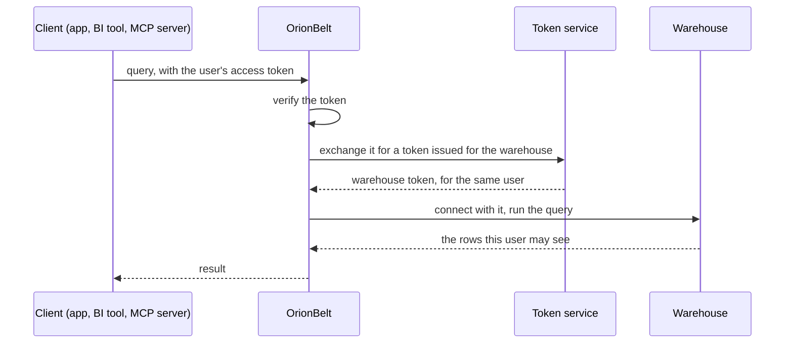

# Warehouse Single Sign-On

With single sign-on to the warehouse, OrionBelt queries Snowflake, Databricks or BigQuery
**as the user who called it**, not as one shared service account. The
warehouse then applies that user's own grants, row-level security and masking,
and its query history names them.

You turn it on per data source, with `DB_<NAME>_AUTH=user`. Other data sources
keep their service login.

## How a query flows

The token service is the warehouse itself (Databricks), your identity provider
(Snowflake) or Google's security token service (BigQuery). OrionBelt never sends the user's own token to the
warehouse: the warehouse only gets a token issued for it.

The exchanged token is kept in memory per data source and user, and exchanged
again a minute before it expires. It is never written to disk or logged.

## What works with what

| Warehouse | Identity provider | Who issues the warehouse token | Guide |
|---|---|---|---|
| Databricks | Any OpenID Connect provider: Entra ID, Okta, Keycloak, ... | Databricks, at your workspace | [Databricks](databricks.md) |
| Snowflake | Entra ID | Entra ID, through its on-behalf-of flow | [Snowflake: Entra ID](snowflake.md#entra-id) |
| Snowflake | Okta, Keycloak, and others with the standard token exchange (RFC 8693) | The identity provider | [Snowflake: Okta](snowflake.md#okta), [Keycloak](snowflake.md#keycloak) |
| BigQuery | Any OpenID Connect provider | Google's security token service, for a member of a workforce pool | [BigQuery](bigquery.md) |

Other dialects refuse `DB_<NAME>_AUTH=user`.

## The three parts to set up

1. **Users sign in to OrionBelt** with your identity provider:
   `AUTH_MODE=oidc`, `OIDC_ISSUER`, `OIDC_AUDIENCE`. See
   [OpenID Connect](../authentication.md#openid-connect) and the
   [notes per identity provider](../authentication.md#identity-provider-notes).
2. **OrionBelt's own client at the identity provider.** Snowflake only:
   `OIDC_CLIENT_ID` with `OIDC_CLIENT_SECRET` or `OIDC_CLIENT_SECRET_FILE`.
   OrionBelt asks for the Snowflake token as this client. Entra ID and
   Keycloak only exchange a token for the client it was issued for, so this is
   the client that `OIDC_AUDIENCE` names.
3. **The warehouse trusts your identity provider**, and the data source logs
   in as the user. Step by step: [Databricks](databricks.md),
   [Snowflake](snowflake.md), [BigQuery](bigquery.md).

OrionBelt runs queries on a database only with `QUERY_EXECUTE=true` (or with
Flight SQL on), as for any data source; the examples in these guides set it.

To try it before you change anything at your identity provider, use a local
Keycloak: [Try it with a local Keycloak](keycloak.md).

## What changes for a data source that logs in as the user

- **Every caller must be a signed-in user.** An API key, or no authentication,
  is refused with 401 `SIGN_IN_REQUIRED`, before any cache lookup. API keys
  keep working for the other data sources. A BI tool's [BI token](../bi-tokens.md)
  is accepted when it holds a
  [warehouse sign-in](../bi-tokens.md#data-sources-that-log-in-as-you).
- **Connections per user.** A connection is opened for its caller, and after
  the query waits for that user's next one, so a user asking several
  questions in a row connects once. Another user never gets it. It is closed
  after five minutes idle (`DB_<NAME>_USER_CONNECTION_IDLE_SECONDS`, default
  300; 0 closes every connection after its query; checked about once a
  minute), a minute before its
  warehouse token expires, or when its query failed. At most one is kept per
  user and `POOL_SIZE` across users; when full, the least recently used one
  is closed. `MAX_CONNECTIONS` still bounds the connections in use.
- **Results are cached per user.** OrionBelt cannot see a user's grants, so one
  user's cached rows are never served to another. The same query asked by ten
  users is ten cache entries.
- **Cached at most five minutes** (`DB_<NAME>_CACHE_MAX_TTL_SECONDS`, default
  300; 0 turns caching off for the source). OrionBelt is not told when a
  user's grants change, so a revoked user may still get **their own** cached
  rows until then, never anyone else's. A query across data sources is cached
  no longer than the strictest source it reads allows. Responses show
  `ttl_source: user_login_capped` when the cap applied.
- **The settings that decide who the user is at the warehouse are part of the
  source's identity**: `DB_<NAME>_OAUTH_CLIENT_ID`, `_OAUTH_EXCHANGE`,
  `_OAUTH_SCOPE`, `_OAUTH_AUDIENCE`, `_WORKFORCE_PROVIDER`,
  `_WORKFORCE_USER_PROJECT`. Two sources that differ in one of them
  share no token and no cached result.
- OrionBelt **refuses to start** when a source logs in as the user and
  `AUTH_MODE` is not `oidc`, or when a Snowflake source does and OrionBelt has
  no client at the identity provider or does not know its token endpoint.

## Queries across data sources

A query whose data objects come from several data sources runs one query per
source and joins the results in OrionBelt ([federation](../federation.md)).
Each of those queries logs in to its source the way that source is set up:

- **A source that logs in as the user** runs its part as the signed-in user.
  Two such sources, say Snowflake and Databricks, mean one sign-in at each,
  and each warehouse applies its own grants and row-level security to its own
  part only.
- **A source with a service account** runs its part as that account, for
  every user. OrionBelt does not filter those rows per user.
- **Every source must accept the caller.** One source that logs in as the user
  refuses an API key, or a BI token without a warehouse sign-in, before any
  part runs.
- **The joined result is cached per user**, no longer than the strictest
  source allows.
- **One failed sign-in fails the whole query**: there is no partial result.
- **Values travel between warehouses.** When OrionBelt narrows one part to the
  keys another part returned ([key injection](../federation.md#key-injection)),
  those keys are written into the second warehouse's query, and so appear in
  its query history under the user's name.

## When a query is refused

| Answer | What it means | What to check |
|---|---|---|
| 401 `SIGN_IN_REQUIRED` | The caller is not a signed-in user: an API key, no authentication, or a [BI token](../bi-tokens.md) without a warehouse sign-in. | Call with the user's access token, or a BI token that holds a [warehouse sign-in](../bi-tokens.md#data-sources-that-log-in-as-you). |
| 401 `BI_TOKEN_SIGN_IN_ENDED` | The identity provider ended the BI token's warehouse sign-in: revoked, the user disabled, or unused for too long. | Create a new BI token. |
| 403 `DATA_SOURCE_SIGN_IN_REFUSED` | The token service refused to issue a warehouse token for this user. The message carries its reason. | The reason usually names what is missing. See the troubleshooting table of [Databricks](databricks.md#troubleshooting) or [Snowflake](snowflake.md#troubleshooting). |
| 401 `DATA_SOURCE_SIGN_IN_INTERACTION_REQUIRED` | The identity provider wants the user at its sign-in page first: multi-factor authentication, conditional access, consent. | Sign the user in again. Over REST, the `WWW-Authenticate` header says where (`authorization_uri`) and carries the identity provider's claims challenge, when it sent one. |
| 503 `DATA_SOURCE_SIGN_IN_UNAVAILABLE` | The token service could not be reached, or failed. | The network from OrionBelt to the token endpoint: `OIDC_TOKEN_ENDPOINT`, the one the discovery document names, or (Databricks) the workspace. |

Flight SQL answers with *unauthenticated*, *unauthorized* or *unavailable*;
pgwire with SQLSTATE 28000, or 57P03 when the token service is unavailable.
